

  

  <a href="#proyectos-destacados">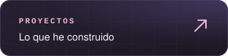</a>
  <a href="https://github.com/juulicanizares?tab=repositories">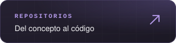</a>
  

  <a href="#sobre-mí">Sobre mí</a> /
  <a href="#tecnologías">Tecnologías</a> /
  <a href="#proyectos-destacados">Proyectos</a> /
  <a href="#github-en-datos">GitHub en datos</a> /
  <a href="#conectemos">Conectemos</a>

## Sobre mí

Soy **Juliana Cañizares**, estudiante de **Campuslands** formándome como **Desarrolladora de Software Junior**. En mi formación he fortalecido mis conocimientos técnicos, mi capacidad para resolver problemas y mis habilidades para trabajar en equipo.

Sigo aprendiendo **desarrollo web, bases de datos y automatización**, y me gusta convertir lo que aprendo en proyectos que funcionen. Me caracterizo por ser comprometida, curiosa y organizada, y busco mi primera oportunidad profesional para aportar y seguir creciendo.

  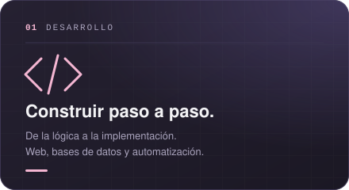
  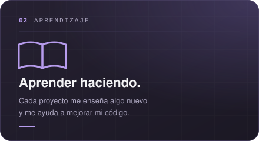

## Tecnologías

  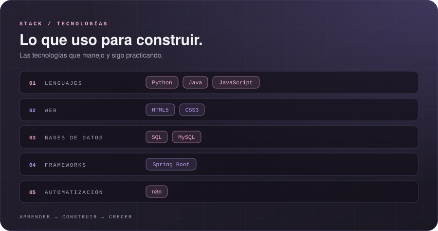

<b>Consultar el stack en texto</b>

- **Lenguajes:** Python, Java, JavaScript
- **Web:** HTML5, CSS3
- **Bases de datos:** SQL, MySQL
- **Frameworks:** Spring Boot
- **Automatización:** n8n

## Proyectos destacados

  <a href="https://github.com/juulicanizares/Taller_MySQL">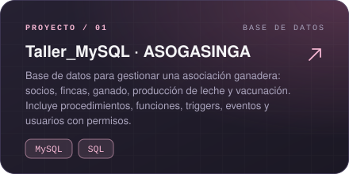</a>
  <a href="https://github.com/juulicanizares/Proyecto-html-ropa">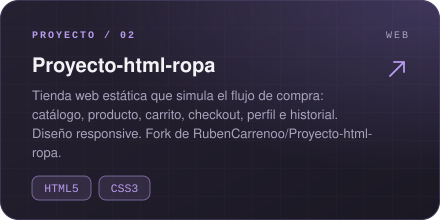</a>

  <a href="https://github.com/juulicanizares/MiPortafolio">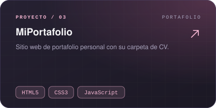</a>
  <a href="https://github.com/juulicanizares/CALCULADORA-PROYECTO-JULIANA">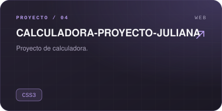</a>

## GitHub en datos

  

## Conectemos

  <a href="mailto:julianacanizares124@gmail.com">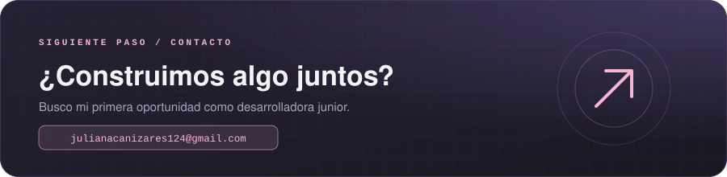</a>

  
  
  <!--
    LinkedIn: quita los símbolos de comentario y cambia TU-USUARIO por tu usuario real.
  
  -->

  Gracias por pasar por mi perfil 💗 — siempre abierta a nuevos retos y proyectos.

  

