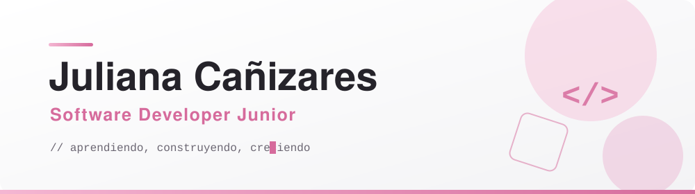

<picture>
  <source media="(prefers-color-scheme: dark)" srcset="banner-dark.svg">
  
</picture>

  

## Hola, soy Juliana

**Software Developer Junior** · en formación en **Campuslands**

Me gusta convertir ideas en proyectos que funcionan y se ven bien, aprendiendo con curiosidad, orden y constancia.

*“Cada línea de código es una oportunidad para aprender algo nuevo.”*

## Sobre mí

Actualmente me estoy formando en **Campuslands** como Desarrolladora de Software Junior, donde he fortalecido mis conocimientos técnicos, mi capacidad para resolver problemas y mis habilidades para trabajar en equipo.

- **Aprendiendo:** desarrollo web, bases de datos y automatización, y explorando Java y Spring Boot.
- **Bases en:** Python, HTML, CSS y JavaScript, con MySQL y n8n.
- **Me caracterizo por:** ser comprometida, curiosa, organizada y con muchas ganas de aprender.
- **Busco:** mi primera oportunidad profesional para aportar y seguir creciendo.
- **Ubicación:** Bucaramanga, Colombia.

## Tecnologías y herramientas

<table>
  <tr>
    <td><b>Lenguajes</b></td>
    <td>
      
      
      
    </td>
  </tr>
  <tr>
    <td><b>Desarrollo web</b></td>
    <td>
      
      
    </td>
  </tr>
  <tr>
    <td><b>Bases de datos</b></td>
    <td>
      
      
    </td>
  </tr>
  <tr>
    <td><b>Frameworks</b></td>
    <td>
      
    </td>
  </tr>
  <tr>
    <td><b>Automatización</b></td>
    <td>
      
    </td>
  </tr>
</table>

## Proyectos destacados

<table>
  <tr>
    <td width="50%" valign="top">
      <h3><a href="https://github.com/juulicanizares/Taller_MySQL">Taller_MySQL · ASOGASINGA</a></h3>
      
Base de datos para gestionar una asociación ganadera: socios, fincas, ganado, producción de leche, vacunación y empleados. Incluye procedimientos almacenados, funciones, triggers, eventos y usuarios con permisos.

      
      
    </td>
    <td width="50%" valign="top">
      <h3><a href="https://github.com/juulicanizares/Proyecto-html-ropa">Proyecto-html-ropa</a></h3>
      
Tienda web estática que simula el flujo de compra: catálogo, detalle de producto, carrito, checkout, perfil e historial. Diseño responsive. Fork de <a href="https://github.com/RubenCarrenoo/Proyecto-html-ropa">RubenCarrenoo/Proyecto-html-ropa</a>.

      
      
    </td>
  </tr>
  <tr>
    <td width="50%" valign="top">
      <h3><a href="https://github.com/juulicanizares/MiPortafolio">MiPortafolio</a></h3>
      
Sitio web de portafolio personal con su carpeta de CV.

      
      
      
    </td>
    <td width="50%" valign="top">
      <h3><a href="https://github.com/juulicanizares/CALCULADORA-PROYECTO-JULIANA">CALCULADORA-PROYECTO-JULIANA</a></h3>
      <!-- Cuando agregues un README a este repo, reemplaza esta descripción por una real. -->
      
Proyecto de calculadora.

      
    </td>
  </tr>
</table>

## Contacto

¿Hablamos de oportunidades como desarrolladora junior o de proyectos en común? Escríbeme:

<!--
  LinkedIn: quita los símbolos de comentario y cambia TU-USUARIO por tu usuario real.

-->

Gracias por pasar por mi perfil 💗 — siempre abierta a nuevos retos y proyectos.

